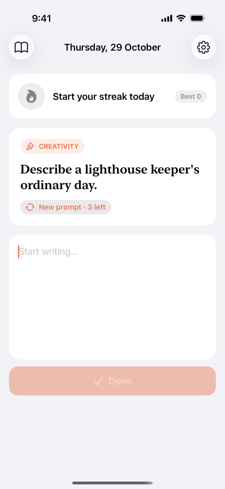
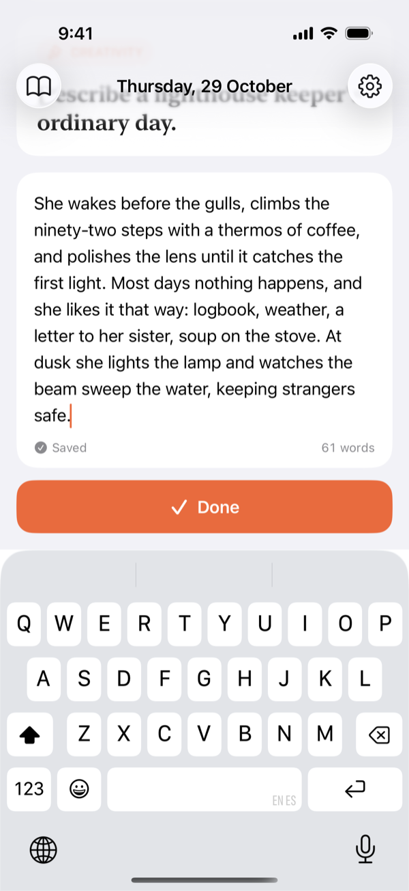
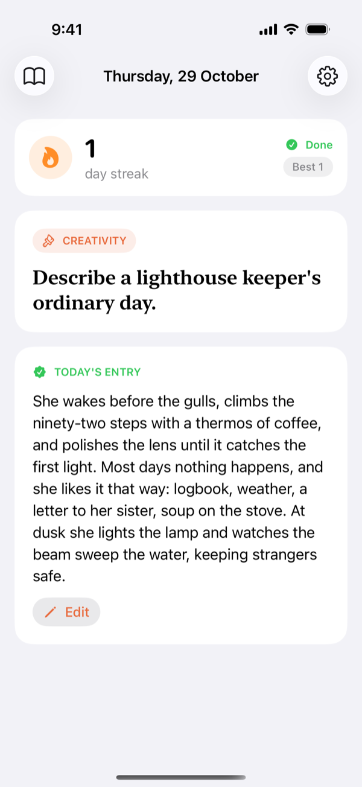
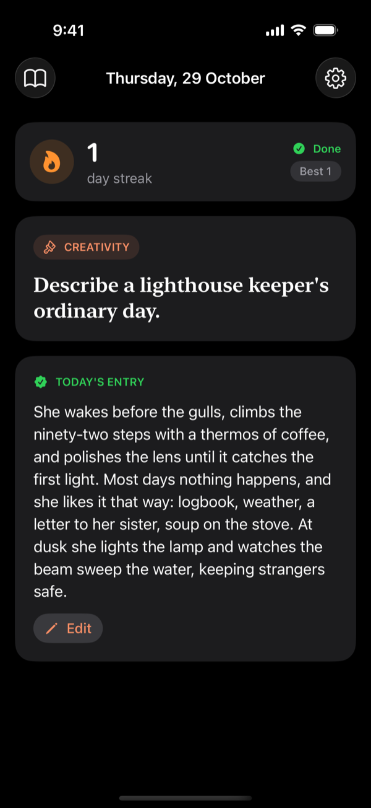
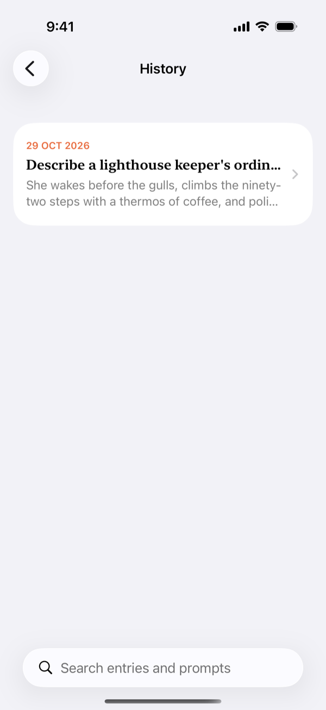
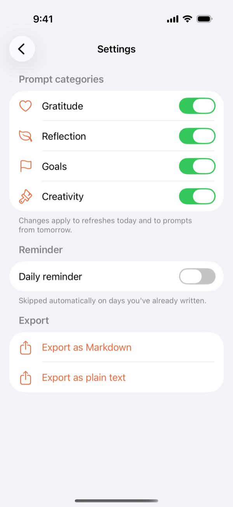
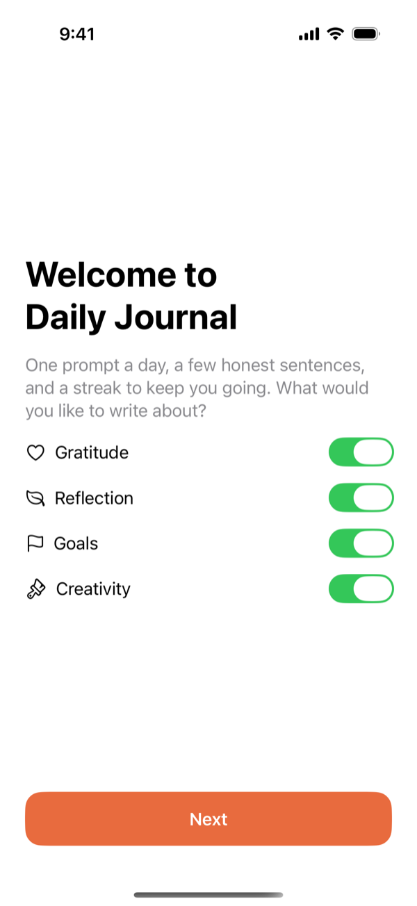

# Daily Journal

An iOS 17+ app that gives you one journaling prompt a day, a quick text entry, a streak counter, and a small Home Screen widget. Built with SwiftUI, SwiftData and WidgetKit using Clean Architecture.

Planning and design documents live in [`aidlc-docs/`](aidlc-docs/).

## Screenshots

<table>
  <tr>
    <td align="center"><br><sub><b>Today's prompt</b></sub></td>
    <td align="center"><br><sub><b>Quick entry with autosave</b></sub></td>
    <td align="center"><br><sub><b>Done for today</b></sub></td>
    <td align="center"><br><sub><b>Dark mode</b></sub></td>
  </tr>
  <tr>
    <td align="center"><br><sub><b>History and search</b></sub></td>
    <td align="center"><br><sub><b>Settings</b></sub></td>
    <td align="center"><br><sub><b>Onboarding</b></sub></td>
    <td></td>
  </tr>
</table>

## Layout

| Path | Contents |
|---|---|
| `JournalCore/` | Swift package: `JournalDomain` (business rules, use cases) and `JournalData` (SwiftData, App Group stores, notifications, prompts) |
| `JournalApp/` | SwiftUI app target (screens, lifecycle, deep links) |
| `JournalWidget/` | WidgetKit extension: small widget with today's prompt and streak, embedded in the app |
| `Project.swift`, `Tuist.swift`, `Tuist/` | Tuist project definition. `Tuist/ProjectDescriptionHelpers/AppIdentifiers.swift` holds every identifier and the Team ID |

The `.xcodeproj` and `.xcworkspace` are generated, not committed.

## Prerequisites

- Xcode 26 (or Xcode 15+ with iOS 17 SDK)
- [Tuist](https://tuist.dev) 4.x (e.g. `mise use -g tuist`)

## Build and run

```sh
tuist generate            # creates DailyJournal.xcworkspace and opens it
# or, headless:
tuist generate --no-open
xcodebuild -workspace DailyJournal.xcworkspace -scheme JournalApp \
  -destination 'platform=iOS Simulator,name=iPhone 15 Pro' build
```

## Tests

```sh
cd JournalCore && swift test     # Domain + Data unit tests, run on the Mac host
```

## Enabling iCloud sync and the App Group (device builds)

By default the project builds **unsigned for the simulator**: no entitlements, CloudKit off, and data stored in the app's own container. To turn on sync and widget data sharing:

1. Set `developmentTeam` in `Tuist/ProjectDescriptionHelpers/AppIdentifiers.swift` to your Apple Developer Team ID.
2. In the Apple Developer portal (or let Xcode do it automatically), register the App Group `group.com.mmomo.dailyjournal` and the iCloud container `iCloud.com.mmomo.dailyjournal`.
3. Run `tuist generate` again. The entitlements (`JournalApp/JournalApp.entitlements`) and `JournalCloudKitEnabled = YES` are applied automatically.

## Widget

Add **Daily Prompt** (small) from the Home Screen widget gallery. It shows today's prompt and your streak, and tapping it opens the editor (`dailyjournal://today`).

The widget reads the app's data through the App Group. Until a Team ID is configured (see above) there's no App Group, so the widget shows "Open Daily Journal to get your first prompt".
