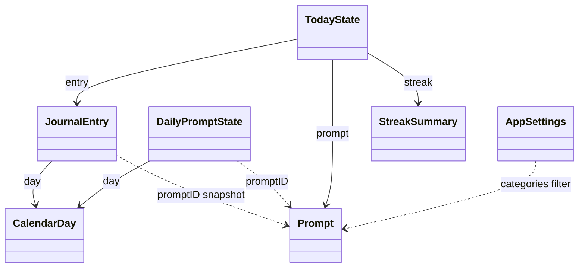

# Domain Entities: Unit 1 Domain (`JournalDomain`)

All types are value types (`struct` or `enum`), `Sendable` and `Equatable`. Persistent ones are also `Codable`. Nothing here depends on any framework except Foundation.

This document **refines** `component-methods.md` §1. Changes are marked **(refined)**.

---

## 1. Time Model

### 1.1 `TimeSource` (port)
| Member | Meaning |
|---|---|
| `now: Date` | Current instant |
| `timeZone: TimeZone` | Device's current time zone **(refined: replaces exposing a `Calendar`)** |

### 1.2 `DayMath` (internal helper, refined)
All day arithmetic uses a **Gregorian calendar** set to `TimeSource.timeZone`, whatever the user's chosen calendar system (Buddhist, Japanese, etc.). Journal days are civil Gregorian dates, so the same entry gets the same `CalendarDay` on every device and calendar setting.

### 1.3 `CalendarDay`
| Field | Type | Invariant |
|---|---|---|
| `year` | Int | 1…9999 |
| `month` | Int | 1…12 |
| `day` | Int | 1…days in that month |

| Derived | Definition |
|---|---|
| `dayNumber` | Days since 2001-01-01 using proleptic Gregorian arithmetic (pure integer math, no time zone). Used for ordering, adding days and prompt sequencing |
| `key` | `"YYYY-MM-DD"` zero-padded, the stable storage and identifier key |
| `adding(days:)` | Integer math on `dayNumber`, then converted back to Y/M/D. Never uses time intervals, so DST can't shift it |
| `init(containing: Date, timeZone:)` | Gregorian Y/M/D of the instant in that time zone |
| `start(in timeZone:)` | First instant of the day (handles DST days that don't start at 00:00) |
| `noon(in timeZone:)` | 12:00 local. If that time doesn't exist because of a DST gap, the next valid instant after it |

`Comparable` by `dayNumber`. A `CalendarDay` never stores a time zone (NFR-3.2).

---

## 2. Prompts

### 2.1 `PromptCategory`
`gratitude`, `reflection`, `goals`, `creativity`. Raw values are the lowercase names (also used in JSON and settings). Display names are a presentation concern.

### 2.2 `Prompt`
| Field | Type | Invariant |
|---|---|---|
| `id` | String | Unique in the library. Format `<category>-<NNN>` (e.g., `gratitude-007`) |
| `category` | PromptCategory | Matches the id prefix |
| `text` | String | 10–200 characters after trimming |

### 2.3 `DailyPromptState` (per device, **refined**)
| Field | Type | Meaning |
|---|---|---|
| `day` | CalendarDay | The day this state belongs to |
| `promptID` | String | Prompt currently shown for the day |
| `refreshesUsed` | Int | 0…3 |
| `shownPromptIDs` | [String] | Every prompt shown that day, in order (daily pick plus refreshes). Refreshes never go back to one of these |
| `categoriesKey` | String | Sorted, comma-joined categories in effect when the daily pick was made (for diagnostics; the prompt isn't recomputed when categories change) |

**(refined)** replaces `recentPromptIDs`. Recent-repeat avoidance is now **stateless** (see business-logic-model §1). Only today's and yesterday's states are kept; older ones are pruned.

---

## 3. Entries

### 3.1 `JournalEntry`
| Field | Type | Invariant |
|---|---|---|
| `id` | UUID | Stable across devices |
| `day` | CalendarDay | The journal day it belongs to (not derived from `createdAt`) |
| `text` | String | Not empty after trimming whitespace (BR-E2). Stored exactly as typed. No max length (Q3:A) |
| `promptID` | String | Prompt answered, frozen at creation |
| `promptText` | String | Snapshot of the prompt text, so entries survive library edits |
| `createdAt` | Date | Instant the entry was first saved |
| `updatedAt` | Date | ≥ `createdAt`. Instant of the last saved edit |

Relationship: **at most one entry per `CalendarDay`** in the domain view. The store can hold more than one temporarily after sync, until `DayEntryMerger` reconciles them (BR-M1).

### 3.2 `EntryEditability`
| Case | Meaning |
|---|---|
| `.editable(until: Date)` | The day is today. An entry can be created or edited until `until` (next local midnight) |
| `.backfillable(until: Date)` | The day is yesterday, it has no entry, and `now` is before today's noon |
| `.locked` | Anything else, including past days with entries, missed days after the deadline, and **future-dated** days (Q4:B) |

### 3.3 `BackfillOffer`
`day` (yesterday), `prompt` (Q6:A), `until` (today's noon).

---

## 4. Streak

### 4.1 `StreakStatus`
| Case | Meaning |
|---|---|
| `.none` | No current streak (current = 0) |
| `.active` | The streak runs through today, or through yesterday with today still open |
| `.atRisk(restorableCount: Int, until: Date)` | Yesterday is missing and today's noon deadline hasn't passed. Backfilling yesterday would restore a run of `restorableCount` days that ended the day before yesterday |

### 4.2 `StreakSummary`
| Field | Type | Meaning |
|---|---|---|
| `current` | Int | ≥ 0 |
| `best` | Int | ≥ `current` |
| `status` | StreakStatus | See above |
| `isTodayDone` | Bool | Today has an entry, or a future-dated entry exists (Q4:B) |

---

## 5. Aggregates and Settings

### 5.1 `TodayState`
| Field | Type |
|---|---|
| `day` | CalendarDay |
| `prompt` | Prompt (the entry's frozen prompt if today is done) |
| `entry` | JournalEntry? (today's entry, or the future-dated entry under Q4:B) |
| `entryEditability` | EntryEditability **(refined: added)** |
| `refreshesRemaining` | Int (0 when today is done) |
| `backfillOffer` | BackfillOffer? |
| `streak` | StreakSummary |
| `onboardingCompleted` | Bool |

### 5.2 `ReminderSettings`
| Field | Default | Invariant |
|---|---|---|
| `isEnabled` | false | n/a |
| `hour` | 20 | 0…23 |
| `minute` | 0 | 0…59 |

### 5.3 `AppSettings`
| Field | Default | Invariant |
|---|---|---|
| `categories` | all four | Never empty |
| `reminder` | defaults above | n/a |
| `onboardingCompleted` | false | n/a |

### 5.4 `ScheduledReminder` **(refined: new)**
| Field | Type | Meaning |
|---|---|---|
| `identifier` | String | `"reminder-" + day.key` |
| `day` | CalendarDay | Day it fires |
| `fireDate` | Date | Local hour:minute on that day, moved to the next valid instant if a DST gap removes it |
| `title` | String | `"Time to journal"` |
| `body` | String | See BR-R4 |
| `deepLink` | DeepLink | `.todayEditor` |

The `ReminderScheduler` port becomes `authorizationStatus()`, `requestAuthorization()` and `replacePending(with: [ScheduledReminder])` **(refined)**.

### 5.5 Export
`ExportFormat`: `.markdown`, `.plainText`. `ExportDocument`: `fileName`, `contents` (UTF-8 text), `utType` hint (`"net.daringfireball.markdown"` or `"public.plain-text"`).

### 5.6 `DeepLink`
| Case | URL |
|---|---|
| `.todayEditor` | `dailyjournal://today` |
| `.backfillEditor` | `dailyjournal://backfill` |

`init?(url:)` accepts only the `dailyjournal` scheme with a known host, and ignores query and fragment. The scheme string is a static constant matching the Tuist Info.plist value.

---

## 6. `JournalError` Catalogue

| Case | Raised by | User-facing meaning (wording owned by Presentation) |
|---|---|---|
| `emptyText` | SaveTodayEntry, BackfillYesterday | "Write something first." |
| `entryLocked` | SaveTodayEntry, RefreshPrompt | "This entry is locked." / "Today's entry is saved, so the prompt is fixed." |
| `backfillNotAvailable` | BackfillYesterday | "Yesterday can no longer be filled in." |
| `noRefreshesLeft` | RefreshPrompt | "No refreshes left today." |
| `categoriesEmpty` | UpdatePromptCategories, CompleteOnboarding | "Choose at least one category." |
| `notificationsDenied` | ConfigureReminder, CompleteOnboarding | "Notifications are off for this app in Settings." |
| `nothingToExport` | ExportJournal | "No entries to export yet." |
| `storageFailure(String)` **(refined: new)** | Any use case whose repository call throws | Generic "Couldn't save. Try again." The message is for logs only |

---

## 7. Relationships Overview

Text alternative: a JournalEntry belongs to one CalendarDay and keeps a snapshot of one Prompt. DailyPromptState (per device) belongs to one CalendarDay and points to one Prompt. TodayState combines the current Prompt, an optional JournalEntry and a StreakSummary. AppSettings categories filter which Prompts are eligible.
