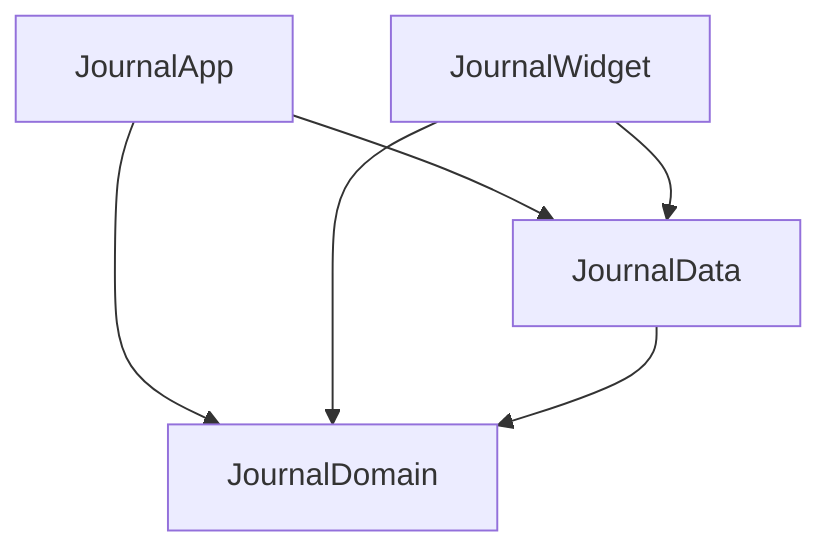

# Application Design (Consolidated)

**Project**: Daily Journaling Prompt iOS App
**Detail documents**: [components.md](components.md) · [component-methods.md](component-methods.md) · [services.md](services.md) · [component-dependency.md](component-dependency.md)

## 1. Design Decisions

| Area | Decision | Source |
|---|---|---|
| Architecture | Clean Architecture: Domain, Data and Presentation, with dependencies pointing inward | Q1 |
| Presentation | Plain SwiftUI. Views call use cases directly, with no view models | FQ1:B |
| Use cases | One per user action, single `execute` method, 15 in total | FQ2:A |
| Modules | Local Swift package `JournalCore` with targets `JournalDomain` (Foundation only) and `JournalData`. App and Widget targets defined in Tuist | FQ3:A, Q8:B |
| Persistence | Repository ports in Domain, SwiftData implementation in Data (`@ModelActor`). Store file in the App Group, synced through the CloudKit private database from the app only | Q2:A, NFR-2.1 |
| Dependency injection | Constructor injection. `JournalEnvironmentFactory` is the composition root; `AppEnvironment` is passed through `.environment` | Q3:A |
| Prompt state | Per device in App Group `UserDefaults` (not synced) | Q4:B |
| Widget data | Widget opens the shared store (CloudKit off) and runs `GetTodayStateUseCase` itself | Q5:A |
| Prompt library | `prompts.json` bundled in JournalData | Q6:A |
| Dependencies | Apple frameworks only at runtime. Tuist is a build tool the user installs | Q7:A, FQ4:B |
| Time | All "now" comes from the injected `TimeSource` port, and days are `CalendarDay` values | NFR-3, NFR-4.2 |

## 2. Layers and Components

| Layer | Components |
|---|---|
| **Domain** (`JournalDomain`) | **Types**: CalendarDay, JournalEntry, Prompt, PromptCategory, DailyPromptState, StreakSummary, EntryEditability, TodayState, AppSettings, ReminderSettings, ExportDocument, DeepLink, JournalError. **Policies**: PromptSelector, EntryEditPolicy, StreakCalculator, DayEntryMerger, JournalExporter, EntrySearchMatcher. **Ports**: TimeSource, EntryRepository, PromptLibrary, PromptStateStore, SettingsStore, ReminderScheduler, WidgetRefresher. **Use cases**: 15 (see below) |
| **Data** (`JournalData`) | EntryRecord (`@Model`), PersistenceController, SwiftDataEntryRepository, BundledPromptLibrary, AppGroupPromptStateStore, AppGroupSettingsStore, UserNotificationReminderScheduler, WidgetCenterRefresher, SystemTimeSource, RemoteChangeObserver, JournalEnvironmentFactory |
| **Presentation: App** | JournalApp, AppEnvironment, RootView, OnboardingView, TodayView, EntryEditorView, StreakView, HistoryView, EntryDetailView, SettingsView, ExportView |
| **Presentation: Widget** | JournalWidgetBundle, PromptStreakWidget, PromptStreakProvider, PromptStreakWidgetView |

## 3. Use Cases → Stories

| Use case | Stories |
|---|---|
| GetTodayState | US-1.1, US-1.2, US-2.5, US-4.1, US-5.1, US-5.3 |
| RefreshPrompt | US-1.3 |
| SaveTodayEntry | US-2.1, US-2.2 |
| BackfillYesterday | US-2.3, US-4.2 |
| GetEntry | US-2.4 |
| ListEntries | US-3.1 |
| SearchEntries | US-3.2 |
| ExportJournal | US-3.3 |
| GetStreak | US-4.1 to US-4.4 |
| GetSettings | US-7.2 |
| UpdatePromptCategories | US-1.4 |
| ConfigureReminder | US-6.1 |
| SyncReminderWithToday | US-6.2, US-6.3 |
| CompleteOnboarding | US-7.1 |
| ReconcileSyncedEntries | US-2.6, US-4.1 |

Every story maps to at least one use case. US-4.3 (reset) is covered by GetStreak and GetTodayState through StreakCalculator.

## 4. Key Orchestrations

- **Load today** (S1): find the day, then the frozen or chosen prompt, the streak and any backfill offer, and return `TodayState`. Shared by the app and the widget.
- **Save / backfill** (S3, S4): check the edit policy, save, then sync the reminder and reload the widget.
- **Refresh prompt** (S2): enforce at most 3 refreshes and no refresh after the entry is saved, then update per-device prompt state and reload the widget.
- **Sync reconciliation** (S5): a remote change triggers a deterministic, idempotent merge of same-day entries, followed by reminder sync and a widget reload.
- **Reminders** (S6): a rolling 7-day window of one-off notifications, so "today" can be skipped once it's done.
- **Day rollover** (S7): the app watches for day changes and foregrounding, plus a timer at 12:00. The widget timeline has entries at now, the next 12:00 and the next midnight.
- **Deep links** (S9): `DeepLink.todayEditor` from the widget or a notification opens TodayView with the editor focused.

## 5. Module Dependencies

Text: App and Widget depend on Data and Domain. Data depends on Domain. Domain depends on Foundation only. There are no cycles, and App and Widget never depend on each other.

## 6. Handed to Functional Design (Core unit)

- PromptSelector algorithm: deterministic seed per day and category set, the 30-day no-repeat window, refresh sequence, and what happens when the selected categories have fewer than 30 prompts
- EntryEditPolicy exact boundaries (midnight, 12:00) under DST and time zone changes
- StreakCalculator rules for current, best and at-risk (including "today written, yesterday missing")
- DayEntryMerger format and deterministic ordering (merging the same conflict twice must give the same result)
- CloudKit-compatible `EntryRecord` schema and the CalendarDay storage key
- Rolling reminder window rules (7 days, notification body, top-up triggers)
- Markdown and plain-text export layouts
- `prompts.json` schema and validation

## 7. Configuration Values Needed Later (Code Generation)

These will be settled in Units Generation or Code Generation. Placeholders until then:
- Bundle identifier prefix (e.g., `com.<you>.journal`)
- App Group identifier (e.g., `group.com.<you>.journal`)
- iCloud container identifier (e.g., `iCloud.com.<you>.journal`)
- Deep link URL scheme (e.g., `dailyjournal://`)
