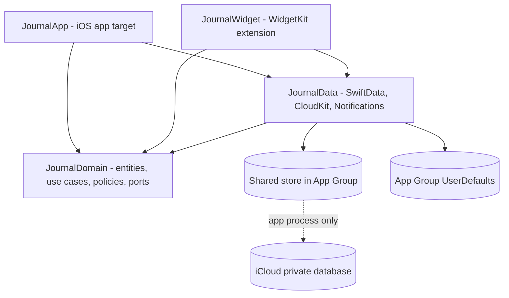
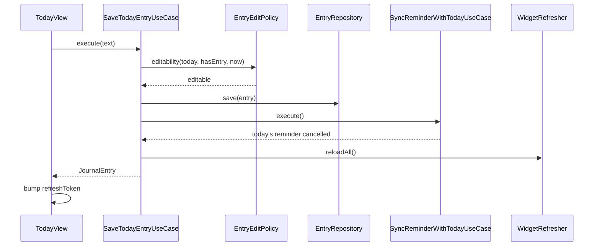

# Component Dependencies

## 1. Module Dependency Rules

| Module | May depend on | Must NOT depend on |
|---|---|---|
| `JournalDomain` | Foundation | SwiftData, SwiftUI, WidgetKit, UserNotifications, JournalData, App, Widget |
| `JournalData` | JournalDomain, SwiftData, UserNotifications, WidgetKit (reload API) | SwiftUI views, App, Widget |
| `JournalApp` | JournalDomain, JournalData, SwiftUI | JournalWidget |
| `JournalWidget` | JournalDomain, JournalData, SwiftUI, WidgetKit | JournalApp |

The rules are enforced by Swift package target dependencies (FQ3:A) and Tuist target dependencies. There are no cycles.

## 2. Module Graph

### Mermaid



### Text Alternative

- JournalApp depends on JournalData and JournalDomain
- JournalWidget depends on JournalData and JournalDomain
- JournalData depends on JournalDomain
- JournalData owns the SwiftData store in the App Group (synced to the iCloud private database in the app process only) and the App Group UserDefaults (prompt state, settings)
- JournalDomain depends on nothing but Foundation

## 3. Component Dependency Matrix (Domain use cases vs. ports and policies)

Legend: R = reads, W = writes, U = uses (pure)

| Use case | TimeSource | EntryRepo | PromptLibrary | PromptState | Settings | Reminder | Widget | Policies |
|---|---|---|---|---|---|---|---|---|
| GetTodayState | R | R | R | R/W | R | | | Selector, Streak, EditPolicy |
| RefreshPrompt | R | R | R | R/W | R | | W | Selector |
| SaveTodayEntry | R | R/W | R | R | R | via SyncReminder | W | EditPolicy |
| BackfillYesterday | R | R/W | R | R | R | | W | EditPolicy, Selector |
| GetEntry | R | R | | | | | | EditPolicy |
| ListEntries | | R | | | | | | |
| SearchEntries | | R | | | | | | SearchMatcher |
| ExportJournal | R | R | | | | | | Exporter |
| GetStreak | R | R | | | | | | Streak |
| GetSettings | | | | | R | | | |
| UpdatePromptCategories | | | | | R/W | | W | |
| ConfigureReminder | | | | | R/W | R/W | | |
| SyncReminderWithToday | R | R | R | R | R | W | | Selector |
| CompleteOnboarding | | | | | W | via ConfigureReminder | W | |
| ReconcileSyncedEntries | R | R/W | | | | via SyncReminder | W | Merger |

## 4. Communication Patterns

| From → To | Pattern | Notes |
|---|---|---|
| Views → Use cases | Direct async calls (`Task { try await env.useCases.x.execute() }`) | No view models (FQ1:B). Errors (`JournalError`) are shown as inline messages |
| Use cases → Ports | Protocol calls (constructor-injected) | Easy to test with fakes and a fixed TimeSource |
| Data → SwiftData | `@ModelActor` repository | Keeps database work off the main thread |
| CloudKit → App | `NSPersistentStoreRemoteChange` notification → `RemoteChangeObserver` → `ReconcileSyncedEntriesUseCase` | App process only; the widget never syncs |
| App → Widget | Shared store + App Group defaults, plus `WidgetCenter.reloadAllTimelines()` | Widget recalculates state itself (Q5:A) |
| Widget/Notification → App | URL deep link (`DeepLink`) | `onOpenURL` / notification delegate |
| System → App | `NSCalendarDayChanged`, `scenePhase`, timer at 12:00 | Triggers refresh, reconcile, reminder sync |

## 5. Data Flow: Saving Today's Entry

### Mermaid



### Text Alternative

```
TodayView -> SaveTodayEntryUseCase.execute(text)
  -> EntryEditPolicy.editability(today) == editable ? else throw entryLocked
  -> EntryRepository.save(entry)
  -> SyncReminderWithTodayUseCase.execute()   (cancel today's reminder)
  -> WidgetRefresher.reloadAll()
  <- returns JournalEntry; TodayView bumps refreshToken
```

## 6. Data Flow: Sync Conflict Reconciliation

```
iCloud import (app process)
  -> RemoteChangeObserver
  -> ReconcileSyncedEntriesUseCase.execute()
       -> EntryRepository.entries(for: day) returns 2+ entries
       -> DayEntryMerger.merge(...) (deterministic, idempotent)
       -> EntryRepository.save(merged); delete(others)
       -> SyncReminderWithTodayUseCase; WidgetRefresher.reloadAll()
  -> AppEnvironment.refreshToken bumped -> visible views reload
```
