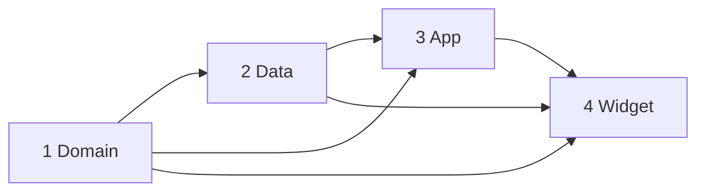

# Unit of Work Dependencies

## 1. Dependency Matrix

Read across: the row unit **depends on** the column unit.

| Unit | Domain | Data | App | Widget |
|---|---|---|---|---|
| **Domain** | n/a | No | No | No |
| **Data** | **Yes** (implements ports, uses entities) | n/a | No | No |
| **App** | **Yes** (use cases, entities, DeepLink) | **Yes** (factory, persistence, RemoteChangeObserver) | n/a | No (embeds it at build time only) |
| **Widget** | **Yes** (GetTodayState, TodayState, DeepLink) | **Yes** (factory `.widget`, PersistenceController) | No | n/a |

There are no cycles. App and Widget are siblings: the App target *embeds* the Widget extension product, but neither imports the other's code.

## 2. Build Order

| Order | Unit | Can start when | Blocks |
|---|---|---|---|
| 1 | Domain | Now | Data, App, Widget |
| 2 | Data | Domain code is approved | App, Widget |
| 3 | App | Data code is approved and Tuist is installed | Widget (embedding, shared entitlements) |
| 4 | Widget | App code is approved | Build and Test |

Widget could technically be built alongside App, since both depend only on Domain and Data. It goes last because the Tuist project, entitlements and App Group setup are created in the App unit, and the widget reuses them.

Text alternative: Domain is first. Data needs Domain. App needs Domain and Data. Widget needs Domain and Data, and is built after App because it is embedded in the App's Tuist project.

## 3. Interfaces Between Units

| Provider → Consumer | Contract |
|---|---|
| Domain → Data | Port protocols (`TimeSource`, `EntryRepository`, `PromptLibrary`, `PromptStateStore`, `SettingsStore`, `ReminderScheduler`, `WidgetRefresher`), the entity types, and the storage schema contracts from Domain Functional Design |
| Domain → App, Widget | Use case types and `execute` signatures, `TodayState`, `StreakSummary`, `EntryEditability`, `JournalError`, `DeepLink` |
| Data → App, Widget | `JournalEnvironmentFactory.make(for: .app / .widget)` → `JournalUseCases`, `PersistenceController`, `RemoteChangeObserver` (app only) |
| App → Widget | Shared Tuist project, App Group entitlement, URL scheme registration (`dailyjournal://`) |

## 4. Shared Resources

| Resource | Owner unit | Used by |
|---|---|---|
| SwiftData store file in App Group container | Data | App (read/write + CloudKit), Widget (read, CloudKit off) |
| App Group `UserDefaults` (settings, per-device prompt state) | Data | App (read/write), Widget (read; may write today's prompt state, see services.md S1) |
| `prompts.json` | Data | App and Widget through `BundledPromptLibrary` |
| Identifiers (`AppIdentifiers.swift`) | App (Tuist) | Data (reads App Group / iCloud IDs from Info.plist keys), Widget |

## 5. Integration Risks and Checks (for Build and Test)

| Risk | Check |
|---|---|
| Widget and app open the same SwiftData store at once | Manual: save in the app with the widget visible; the widget updates and nothing crashes |
| The App Group ID doesn't match between entitlements and code | Data reads the ID from Info.plist set by Tuist; a single source prevents drift |
| CloudKit can't be tested without a Team ID (Q4:A) | Sync stories (US-2.6) are tested at the logic level in Domain (merger) and Data (repository). Device sync testing is deferred until a Team ID is added |
