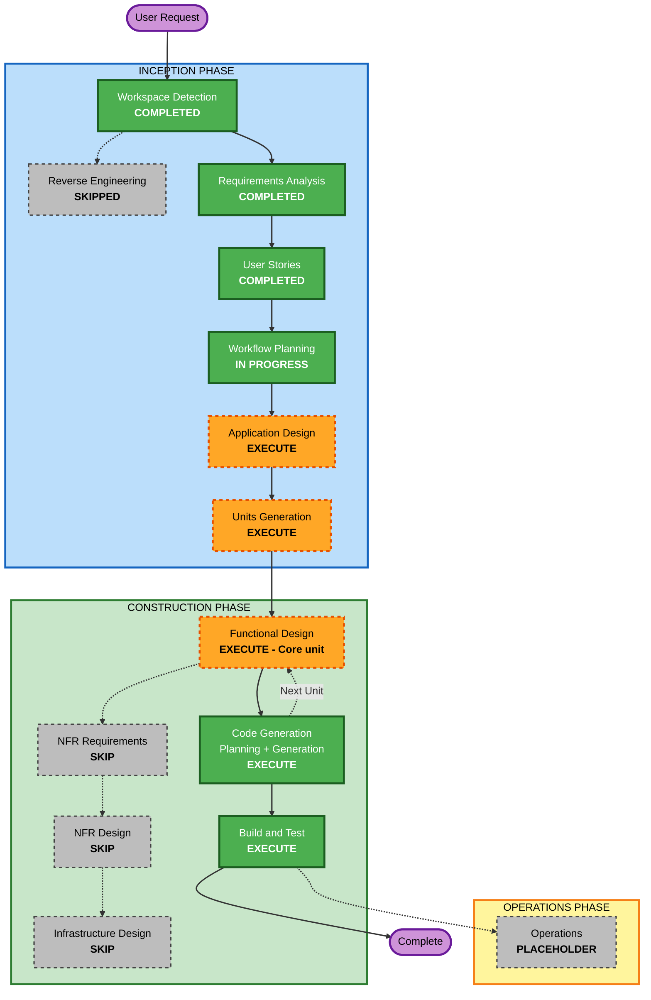

# Execution Plan

**Project**: Daily Journaling Prompt iOS App (Greenfield)
**Inputs**: `requirements.md` (approved), `stories.md` + `personas.md` (approved, 25 stories, 6 open points accepted as proposed)

## Detailed Analysis Summary

### Change Impact Assessment
- **User-facing changes**: Yes. The entire app is new: Today screen, History, Settings, onboarding, widget and notifications.
- **Structural changes**: Yes. New architecture with three parts: iOS app target, WidgetKit extension, and shared core logic that both use through an App Group.
- **Data model changes**: Yes. New SwiftData model (entries keyed by calendar day, prompt state, refresh count, settings) that has to fit CloudKit's limits (no unique constraints, every attribute optional or defaulted).
- **API changes**: No external APIs. Internal interfaces between core logic, app and widget need defining, including the deep-link URL.
- **NFR impact**: Moderate. Tech stack is already fixed (iOS 17, SwiftUI, SwiftData, WidgetKit, CloudKit). The main NFR risks are date/time correctness, sync merging, and how quickly the editor opens. Security, Resiliency and PBT extensions are disabled.

### Risk Assessment
- **Risk Level**: Medium-Low. Personal/demo project with no production users. The main technical unknowns are CloudKit-backed SwiftData merge behavior and keeping the widget's timeline in step with the app.
- **Rollback Complexity**: Easy (greenfield, version-controlled)
- **Testing Complexity**: Moderate. The time-based rules need a fixed test clock. Widget and sync behavior need manual checks on a device or simulator.

## Workflow Visualization

### Mermaid Diagram



### Text Alternative

```
Phase 1: INCEPTION
- Workspace Detection ........ COMPLETED
- Reverse Engineering ........ SKIPPED (greenfield)
- Requirements Analysis ...... COMPLETED
- User Stories ............... COMPLETED
- Workflow Planning .......... IN PROGRESS
- Application Design ......... EXECUTE
- Units Generation ........... EXECUTE

Phase 2: CONSTRUCTION (per unit)
- Functional Design .......... EXECUTE (Core unit only)
- NFR Requirements ........... SKIP
- NFR Design ................. SKIP
- Infrastructure Design ...... SKIP
- Code Generation ............ EXECUTE (every unit)
- Build and Test ............. EXECUTE (after all units)

Phase 3: OPERATIONS
- Operations ................. PLACEHOLDER
```

## Phases to Execute

### 🔵 INCEPTION PHASE
- [x] Workspace Detection (COMPLETED)
- [x] Reverse Engineering (SKIPPED: greenfield)
- [x] Requirements Analysis (COMPLETED)
- [x] User Stories (COMPLETED)
- [x] Workflow Planning (IN PROGRESS)
- [ ] Application Design - **EXECUTE**
  - **Rationale**: Every component is new. The responsibilities and interfaces of the prompt engine, entry rules, streak calculator, persistence/sync merger, reminder scheduler, widget timeline provider and exporter need defining. So does how the app and widget share them (App Group, deep links, widget reload triggers).
- [ ] Units Generation - **EXECUTE** (light)
  - **Rationale**: The code naturally splits into separately buildable units that depend on each other. The likely split is a shared **Core** Swift package (domain logic + persistence), the **App** target, and the **Widget** extension. Core comes first because both the others depend on it. This stage confirms the split and the build order.

### 🟢 CONSTRUCTION PHASE
- [ ] Functional Design - **EXECUTE for the Domain unit; expected SKIP for Data, App and Widget** (updated in Units Generation: Core split into Domain + Data, Q1:B)
  - **Rationale**: Core holds the complex business rules: deterministic prompt selection with no repeats in 30 days and a refresh limit, edit and backfill windows, streak with the grace and at-risk states, calendar-day keys that survive time zone and DST changes, and merging same-day entries after sync. The data model must also work with CloudKit. App and Widget are mostly presentation over Core, so functional design is expected to be skipped for them. This will be confirmed per unit.
- [ ] NFR Requirements - **SKIP**
  - **Rationale**: The tech stack is already fixed in requirements (NFR-1). Security, Resiliency and PBT extensions are disabled. The remaining NFRs (time correctness, editor opening in about 1 second, search speed, offline use) are concrete and testable, and will be handled in Functional Design and Code Generation.
- [ ] NFR Design - **SKIP**
  - **Rationale**: NFR Requirements is skipped. No extra NFR patterns are needed beyond what Application Design covers.
- [ ] Infrastructure Design - **SKIP**
  - **Rationale**: No servers or cloud infrastructure. The only platform setup is the iCloud/CloudKit container, App Group and notification capability, and these are configured as Xcode entitlements during Code Generation.
- [ ] Code Generation - **EXECUTE (ALWAYS)**, per unit
  - **Rationale**: Implementation of each unit with unit tests (NFR-4.1). The Given/When/Then scenarios from stories.md become test cases using a fixed test clock.
- [ ] Build and Test - **EXECUTE (ALWAYS)**
  - **Rationale**: Instructions to build and test, including `xcodebuild` and `swift test`, plus manual checks of the widget, notifications and two-device sync.

### 🟡 OPERATIONS PHASE
- [ ] Operations - PLACEHOLDER
  - **Rationale**: Future deployment and monitoring workflows. Not in scope for a personal/demo build.

## Proposed Unit Order (confirmed in Units Generation)

| Order | Unit | Depends on | Notes |
|---|---|---|---|
| 1 | Core (Swift package) | none | Models, prompt library, rules, streak, persistence, sync merge, export. Fully unit-tested |
| 2 | App (iOS target) | Core | Today, History, Settings, onboarding, reminders, deep-link handling |
| 3 | Widget (WidgetKit extension) | Core | Small widget, timeline provider, deep link |

## Estimated Timeline
- **Stages remaining**: 4 inception/construction stages (Application Design, Units Generation, Functional Design for Core, then Code Generation × 3 units), followed by Build and Test
- **Approval gates remaining**: about 8
- **Estimated duration**: a few focused working sessions, mostly limited by how quickly each gate is reviewed

## Success Criteria
- **Primary Goal**: A working iOS 17+ app and small widget that give a daily curated prompt, a quick one-per-day entry, a streak with grace rules, reminders, history, search and export, with iCloud sync
- **Key Deliverables**:
  - Xcode project with App target, Widget extension and Core Swift package in the workspace root
  - Bundled prompt library (365+ prompts across 4 categories)
  - Unit tests for Core logic covering the story acceptance scenarios
  - Build and test instructions
- **Quality Gates**:
  - All Core unit tests pass (`swift test` / `xcodebuild test`)
  - App and widget build for the iOS 17 simulator without warnings that block running
  - Every story in stories.md traced to code or a manual test step
